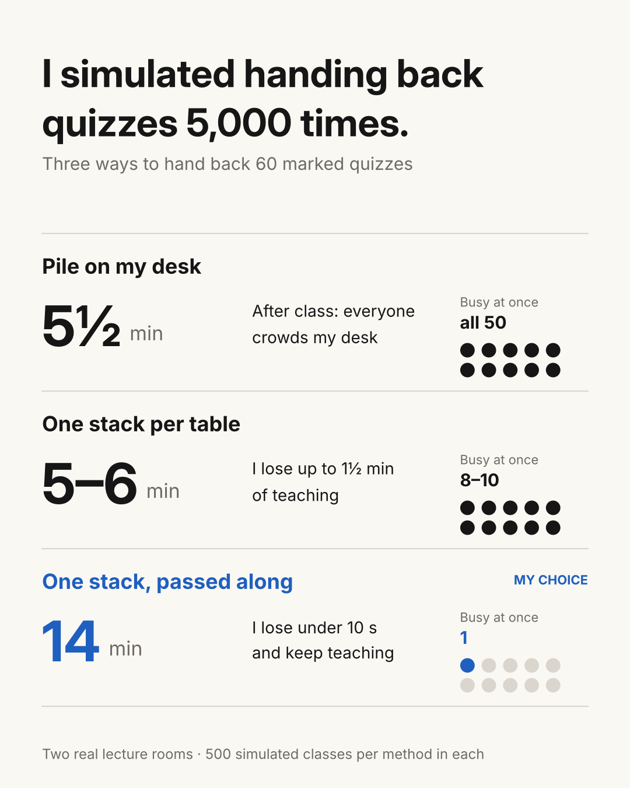
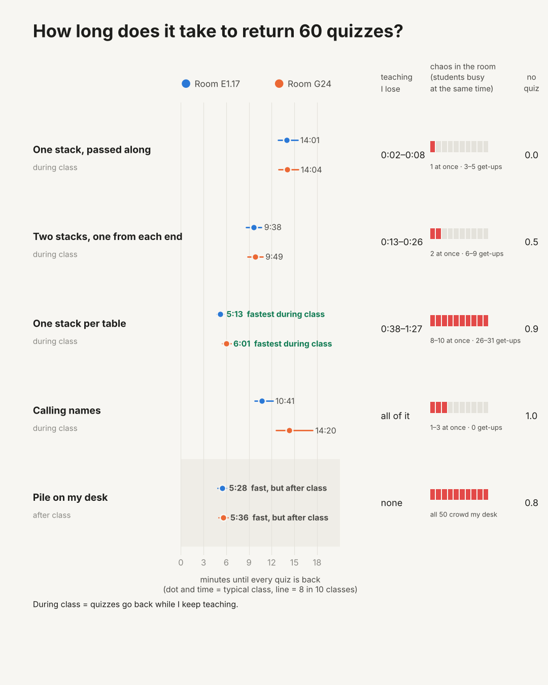

# Handing back 60 quizzes: a classroom simulation

I teach two classes of about 50 students and regularly hand back about 60 marked
quizzes. Calling out names is slow (and I struggle with many of the names), and
leaving a pile on my desk causes a crush at the end of class, with leftover
quizzes lying around. So, inspired by airline-boarding simulations, I built a
model of my two lecture rooms and tested five ways of handing quizzes back, in
**5,000 simulated classes**.



**[Watch the 72-second video](docs/video.mp4)** · **[The maths in plain English](docs/the-maths.md)** · **[3-page summary (PDF)](docs/summary-3-pages.pdf)** · **[Full technical report (PDF)](docs/technical-report.pdf)**

---

## What I found

Typical class (median of 500 simulated classes per room):

| Method | Room E1.17 | Room G24 | Teaching I lose | Students busy at once |
|---|---|---|---|---|
| One stack, passed along | 14:01 | 14:04 | under 10 s | 1 |
| Two stacks, one from each end | 9:38 | 9:49 | 13–26 s | 2 |
| One stack per table | **5:13** | **6:01** | 38 s – 1½ min | 8–10 |
| Calling names, I walk each quiz over | 10:41 | 14:20 | all of it | 1–3 |
| Pile on my desk, after class | 5:28 | 5:36 | none (after class) | all 50 |

- **One stack per table is the fastest during class,** but also the most
  chaotic: up to 10 students busy at once, and students get up 26–31 times per
  class.
- **One stack passed along is slow but almost invisible.** It costs me only a few
  seconds of teaching, and the class barely notices.
- **The pile is quick but happens after class,** and everyone crowds my desk.
- **The surprise:** splitting the stack does not reduce how much anyone reads.
  On average each student checks 30.5 sheets either way. Splitting only helps
  because people search at the same time. [Why?](docs/the-maths.md#4-the-surprise-splitting-the-stack-doesnt-reduce-reading)



---

## How it works, in one minute

1. **The room is a grid of 40 cm squares,** one person per square, built from
   sketches of my two lecture rooms. People walk at measured human speeds and
   take the shortest route around the furniture.
2. **Finding your quiz is a probability problem.** In a shuffled stack your
   sheet is equally likely to be anywhere, so you check half the stack on
   average. Each sheet takes about 0.6 s, and everyone reads at their own pace.
3. **Each method has its own rules:** who gets the stack first, who it goes to
   next, and when someone has to get up.
4. **Every method is played out in the same 500 random classes per room,** so
   the comparison is fair.
5. **The code is tested against the maths.** 200,000 shuffles reproduce the
   formulas.

The full explanation, with no maths background needed, is in
**[docs/the-maths.md](docs/the-maths.md)**.

### What's measured and what's a guess

Walking speeds and the grid size come from published research. Room sizes,
reading speed, hand-over times and the other timings are **estimates**. Each was
varied up and down to check that the conclusions hold; see
[the sensitivity results](outputs/sensitivity.md). The next step is to time a
real class and recalibrate.

---

## Run it yourself

You need Python 3.10+ and, for the videos, [ffmpeg](https://ffmpeg.org/download.html).

```bash
python -m venv .venv
source .venv/bin/activate            # Windows: .venv\Scripts\activate
pip install -r requirements.txt

python tests/test_search_math.py     # code vs. the probability formulas
python tests/test_sanity.py          # every quiz accounted for, no overlaps
python run_experiments.py --runs 20  # quick look (default: 500 per method and room)
python run_sensitivity.py            # vary each assumption
python make_videos.py                # one video per method -> outputs/videos/
python make_chart.py                 # comparison chart
python make_cover.py                 # cover image
python make_linkedin.py              # cover + clips stitched into one video
```

To model a different room, edit or copy a file in `config/rooms/`. Rooms are
plain text, in metres. Behaviour settings are in `config/params.yaml`.

## What's in here

```
config/          room layouts and behaviour settings
quizsim/         the simulation
  layout.py        grid, furniture, seats, passing route, path finding
  search.py        finding your own sheet (the probability model)
  stacks.py        stack methods (one stack, two stacks, per table)
  calling.py       calling names
  pile.py          pile on the desk (crowd model)
  render.py        video frames
tests/           checks against the maths and whole-class sanity checks
outputs/         results: runs.csv (every simulated class), summaries
docs/            plain-English maths, reports (PDF), images, video
report/          LaTeX source of the two reports
METHODS.md       compact technical description and parameter list
```

## References

The main sources are Burstedde et al. (2001) for the grid model, Weidmann (1993)
for walking speeds, Treisman & Gelade (1980) and Wolfe (1998) for visual search,
and Law (2015) for simulation methodology. The full list is in
[docs/the-maths.md](docs/the-maths.md#references) and the technical report.

## Author

Muhammad B. Arif, University College Dublin.
Built with the help of Claude (Anthropic).

## Licence

MIT. See [LICENSE](LICENSE).
