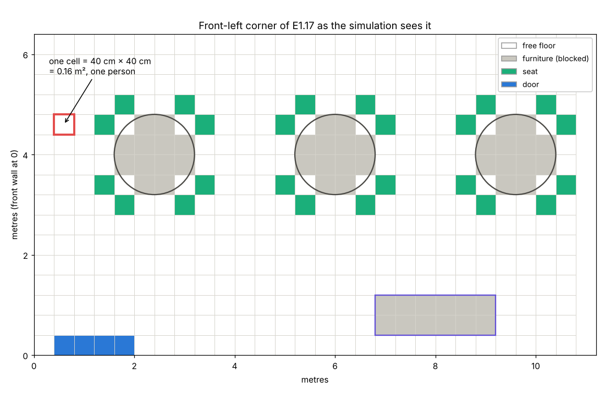
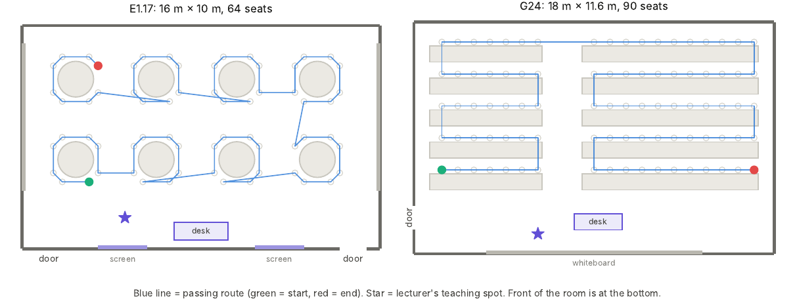

# The maths, in plain English

This page explains every idea behind the simulation without assuming a
maths background. If you want the formal version with proofs, see the
[technical report](technical-report.pdf). If you want something you can read in
five minutes, see the [3-page summary](summary-3-pages.pdf).

---

## 1. Finding your own quiz in a stack

You are handed a shuffled stack of 60 quizzes. You flick through from the top
until you find yours. How many do you look at?

### Every position is equally likely

Look at the top sheet. There are 60 sheets and one is yours, so the chance it's
the top one is **1 in 60**.

If it wasn't, look at the next one. There are now 59 sheets you haven't ruled
out, so the chance this one is yours is **1 in 59**. If not, the next is
**1 in 58**, and so on. Each step gets a little more likely, because you keep
ruling sheets out.

Now ask a different question before you start: what's the chance your sheet is
exactly **3rd**? For that, the 1st must not be yours, the 2nd must not be
yours, and the 3rd must be:

> (59/60) × (58/59) × (1/58) = **1/60**

The numbers cancel, and you get 1/60 again. The same happens for every
position. So your sheet is equally likely to be anywhere in the stack, which is
exactly what "shuffled" means.

### On average, you check half the stack (plus a half)

Some days your sheet is 2nd, some days 57th. The **expected value** is what you
get if you average over many, many tries: the long-run average.

Since every position from 1 to 60 is equally likely, the average is the
average of the numbers 1 to 60. Pair them from the outside in: 1 with 60,
2 with 59, 3 with 58… Every pair adds up to 61, so the average is
61 ÷ 2 = **30.5**.

In general, for a stack of *n* sheets you check **(n + 1) / 2** on average.
Nobody ever checks exactly 30.5 sheets; it's what happens *on average* across
lots of students and lots of classes. When the code shuffled a stack 200,000
times, the average came out at 30.57.

### The stack stays "fair" as it shrinks

When a student takes their sheet out, the remaining sheets are still in random
order: removing one card from a shuffled deck doesn't un-shuffle the rest. So
the next student faces the same situation with one fewer sheet. The first
student checks about 30 sheets on average; a student near the end, holding
about 11 sheets, checks about 6.

---

## 2. From sheets to seconds

Each search takes:

> **time = a + b × (sheets checked)**

- **a = 3 seconds**: picking up the stack and getting started.
- **b = 0.6 seconds**: looking at one name and flicking to the next.

This "one at a time until you find it" pattern is what psychologists call a
*serial self-terminating search* (Treisman & Gelade, 1980; Wolfe, 1998). For a
full stack of 60, the average search takes 3 + 0.6 × 30.5 ≈ **21 seconds**.

People aren't identical, so each simulated student gets their own *b*. Most are
close to 0.6 s, and a few are noticeably slower. That lopsided spread (a
"log-normal" distribution) is the usual shape for human reaction times
(Luce, 1986).

**Adding it up for one stack and 50 students:** the stack shrinks from 60 to
11 sheets as it goes round, and the expected searches add up to about
11½ minutes. Add 50 hand-overs of 2 seconds each and you get about
13 minutes. The full simulation says 14; the extra minute is people getting up
to pass across gaps and taking the leftovers to the desk.

---

## 3. Missing your own sheet

Sometimes you flick straight past your own name. We assume this happens
**2% of the time**. That's a guess (see section 8), but it's tested.

- **If you're holding every unclaimed sheet** (one stack), you know yours must
  be there, so you go through again. You only lose it if you miss it twice:
  0.02 × 0.02 = **0.04%**.
- **If there are other stacks going round**, you can't be sure your sheet was in
  this one, so you pass it on. If you missed it, you won't see it again. That's
  why methods with several stacks leave about 1 student per class without
  their quiz.

**Where a Poisson distribution does fit.** The number of students per class
who end up without their quiz is a count of rare, independent events, so it
behaves like a Poisson count. With one stack, its average is
50 × 0.0004 = 0.02 per class, which is what the simulation shows.

Poisson is *not* the right tool for the number of sheets you check. That isn't
a rare-event count; your sheet is at one definite position, and section 1
gives the exact answer.

---

## 4. The surprise: splitting the stack doesn't reduce reading

Split the 60 sheets into 4 stacks of 15. What's the chance your sheet is in the
first stack that reaches you?

| Stack you're handed | Chance yours is in it (if it wasn't in the earlier ones) |
|---|---|
| 1st | 15 / 60 = 1/4 |
| 2nd | 15 / 45 = 1/3 |
| 3rd | 15 / 30 = 1/2 |
| 4th | 15 / 15 = certain |

Before you start, each of the 4 stacks is equally likely to be the right one,
for the same reason as in section 1. So on average:

- you look through 1½ wrong stacks, reading all 15 sheets in each (22.5 sheets), and
- you read about 8 sheets of the right stack.

**Total: 30.5 sheets**, exactly the same as one big stack.

Splitting the stack doesn't make anyone read less. It's faster only because
several students search **at the same time**. That's also why it's more
chaotic: up to 10 students are busy at once, and stacks have to travel between
tables.

---

## 5. The pile on the desk is a queue

At the desk, only about 4 people can get their hands on the pile at once. Each
of them searches a chunk of it, swapping chunks until they find their sheet:
the same maths as section 4, plus a few seconds per swap.

On average a turn at the pile takes about 23 seconds. Four "counters" serving
50 people therefore need about 50 × 23 ÷ 4 ≈ 290 seconds, plus packing up and
walking. That's roughly **5 minutes**, close to the simulated 5½. This is basic
queueing theory (Kleinrock, 1975).

---

## 6. The room and how people move

- **A grid of 40 cm squares.** The floor is divided into squares of
  40 cm × 40 cm = **0.16 m²**, and each holds at most one person. That's about
  the floor space one person takes up in a tight crowd: the standard choice in
  pedestrian models (Burstedde et al., 2001). Tables, benches and the desk are
  blocked squares.
- **Room sizes are estimates.** They come from hand-drawn sketches, not measured
  floor plans.
- **Walking.** People walk at speeds drawn from real measurements: 1.34 m/s on
  average, with a standard deviation of 0.26 m/s (Weidmann, 1993), slowed by
  20% for walking between furniture. They take the shortest route around
  obstacles, wait if someone is in the way, and look for another route after
  2 seconds.
- **Passing.** On the same bench or table, stacks are always passed seated.
  Between rows or tables, students lean across if the gap is under 2.5 m;
  otherwise someone gets up and walks it over.

---

## 7. Making the comparison fair

**Many random classes.** Each method was played out in **500 random classes
per room**: random seats, a random shuffle, random absentees and random
reading speeds. Five methods × two rooms × 500 classes = **5,000 simulated
classes**.

**The same classes for every method.** Class number 17 uses "random seed" 17 in
every method, so every method faces exactly the same seating, shuffle and
people. Differences between methods come from the method, not from luck. This
is called *common random numbers* (Law, 2015).

**How results are reported.**

- **The median** is the typical class: half of the classes finish faster, half
  slower.
- **The 8-in-10 range** is the span from the 10th to the 90th percentile. Eight
  classes out of ten fall inside it.
- **Confidence intervals** (in the technical report) say how precisely 500
  classes pin down that median. Here it's to within a few seconds.

**Checking the code.** The search code was run 200,000 times and compared with
the formulas above. For example, it checks 30.57 sheets on average where the
maths predicts 30.5, and every position comes up equally often. Separate tests
check that every quiz is accounted for and that no two people ever stand in the
same square.

---

## 8. What is measured, and what is a guess

| Number | Value | Where it comes from |
|---|---|---|
| Grid square | 40 cm | Standard in pedestrian models (Burstedde et al., 2001) |
| Walking speed | 1.34 m/s ± 0.26 | Measured (Weidmann, 1993) |
| Indoor slow-down | ×0.8 | Guess |
| Room sizes | 16 × 10 m, 18 × 11.6 m | Estimated from sketches |
| Time per sheet, *b* | 0.6 s | Guess, agreed with the lecturer |
| Setup time, *a* | 3 s | Guess |
| Missing your sheet | 2% | Guess |
| Hand-over | 2 s, seated within 2.5 m | Guess |
| Calling names: repeat a name | 30% | Guess (the lecturer finds the names hard) |
| People at the pile at once | 4 | Guess |
| Nobody gives up at the pile | — | The lecturer's own observation |

**What if the guesses are wrong?** Each guess was halved or doubled, roughly,
one at a time: 40 settings in total ([sensitivity results](../outputs/sensitivity.md)).
One stack per table was always the fastest during class, and two stacks always
beat one stack. Reading speed *b* matters most: one stack takes 9 to 20 minutes
depending on it. That's the number most worth measuring in a real class.

---

## References

- Burstedde, C., Klauck, K., Schadschneider, A. & Zittartz, J. (2001). Simulation of pedestrian dynamics using a two-dimensional cellular automaton. *Physica A*, 295, 507–525.
- Kirchner, A. & Schadschneider, A. (2002). Simulation of evacuation processes using a bionics-inspired cellular automaton model for pedestrian dynamics. *Physica A*, 312, 260–276.
- Kleinrock, L. (1975). *Queueing Systems, Volume 1: Theory*. Wiley.
- Law, A. M. (2015). *Simulation Modeling and Analysis* (5th ed.). McGraw-Hill.
- Luce, R. D. (1986). *Response Times*. Oxford University Press.
- Treisman, A. M. & Gelade, G. (1980). A feature-integration theory of attention. *Cognitive Psychology*, 12, 97–136.
- Weidmann, U. (1993). *Transporttechnik der Fussgänger*. Schriftenreihe des IVT Nr. 90, ETH Zürich.
- Wolfe, J. M. (1998). What can 1 million trials tell us about visual search? *Psychological Science*, 9(1), 33–39.
